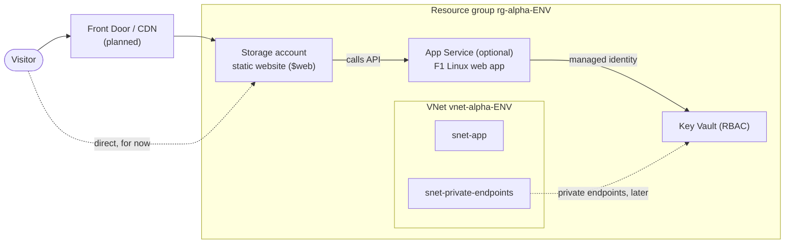

# Azure-Terraform-Project-Alpha

A learning / portfolio project: a **three-tier Azure architecture** written in
Terraform and laid out for **multiple environments** (dev, staging, prod), built
through an issue → branch → PR workflow.

> **Status:** foundation scaffold. Nothing has been applied; no Azure resources exist yet.

## Architecture

| Tier | Module | What it creates |
| --- | --- | --- |
| Network | [`modules/networking`](modules/networking) | VNet + subnets (`for_each`) |
| Presentation | [`modules/storage`](modules/storage) | StorageV2 account serving a **blob static website**; **CDN / Front Door** documented as the next step |
| Application (optional) | [`modules/app`](modules/app) | **App Service** plan (F1 free tier by default) + Linux web app with a managed identity; toggled by `enable_app_service` |
| Secrets | [`modules/secrets`](modules/secrets) | **Key Vault** using Azure RBAC |



## Repository layout

```
.
├── main.tf            # module wiring (app module is optional via count)
├── variables.tf       # environment, location, name_prefix, tags, enable_app_service, ...
├── outputs.tf
├── versions.tf        # Terraform >= 1.5.0, azurerm ~> 5.13, empty azurerm backend
├── environments/
│   ├── dev/       {dev.tfvars, backend.hcl}
│   ├── staging/   {staging.tfvars, backend.hcl}
│   └── prod/      {prod.tfvars, backend.hcl}
├── modules/
│   ├── networking/  {main,variables,outputs}.tf
│   ├── storage/     {main,variables,outputs}.tf
│   ├── app/         {main,variables,outputs}.tf
│   └── secrets/     {main,variables,outputs}.tf
├── ci/README.md       # how CI works (workflow lives in .github/workflows)
└── docs/LEARNING.md   # the learning path
```

## Environments

One root configuration, three environments. Each environment has its own
variable file **and its own remote state** (a separate storage account), passed
in at init time through the empty `backend "azurerm" {}` block.

```bash
# Dev
terraform init -backend-config=environments/dev/backend.hcl
terraform plan -var-file=environments/dev/dev.tfvars

# Switching environments: re-init against that env's backend
terraform init -reconfigure -backend-config=environments/staging/backend.hcl
terraform plan -var-file=environments/staging/staging.tfvars
```

The `backend.hcl` files contain `REPLACE_ME` placeholders and use
`use_azuread_auth = true` (Entra ID, no storage keys). Fill them in once the
state storage exists.

Validate without any Azure access:

```bash
terraform fmt -check -recursive
terraform init -backend=false
terraform validate
```

| | dev | staging | prod |
| --- | --- | --- | --- |
| VNet | 10.10.0.0/16 | 10.20.0.0/16 | 10.30.0.0/16 |
| App Service | on (F1) | off | off |
| Key Vault purge protection | off | off | on |

## CI

[`.github/workflows/terraform.yml`](.github/workflows/terraform.yml) runs fmt, init, validate and plan (dev by
default) on every PR and on demand. Until the `ARM_*` secrets and real backend
values exist it runs the credential-free checks and skips the plan. See [`ci/README.md`](ci/README.md).

## Learning goals

- Write idiomatic Terraform (1.5+): modules, `for_each`, `dynamic`, `moved`/`import` blocks, validation.
- Run one codebase across dev/staging/prod with isolated remote state.
- Use secure defaults: Entra ID auth for state, Key Vault RBAC, managed identities, TLS 1.2, OIDC for CI.
- Practise a real team workflow: issues, conventional-commit PRs, CI gates, SHA-pinned actions.
- Add policy-as-code (tflint, Checkov, OPA, Azure Policy) and get comfortable with state surgery.

The step-by-step path is in [`docs/LEARNING.md`](docs/LEARNING.md).

## Workflow

- One issue per piece of work; branches named `<type>/<short-description>` (e.g. `feat/networking-module`).
- PR titles are conventional commits (`feat:`, `fix:`, `docs:`, `ci:`, `chore:`) and become the squash commit.
- Every PR closes its issue and needs a green **Terraform** check.

## License

[MIT](LICENSE)
